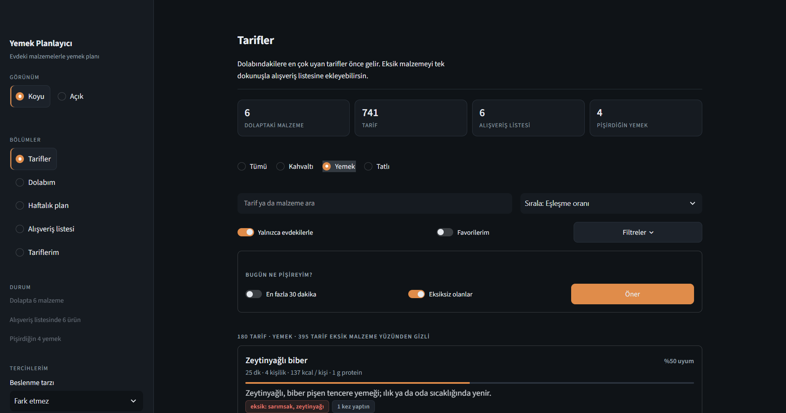
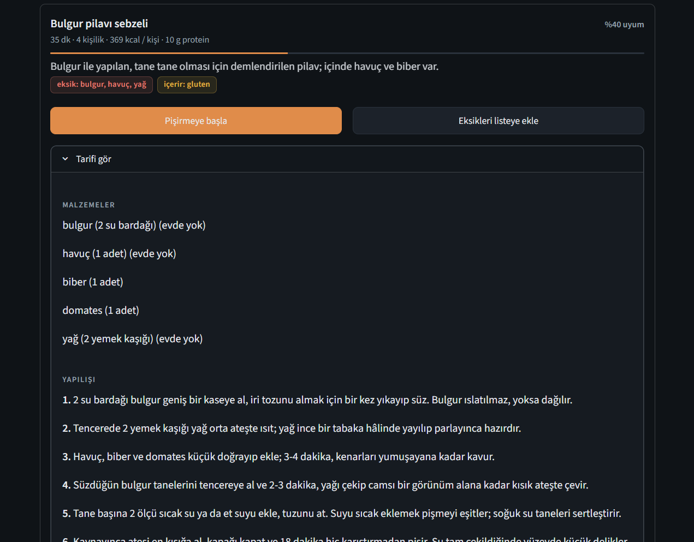
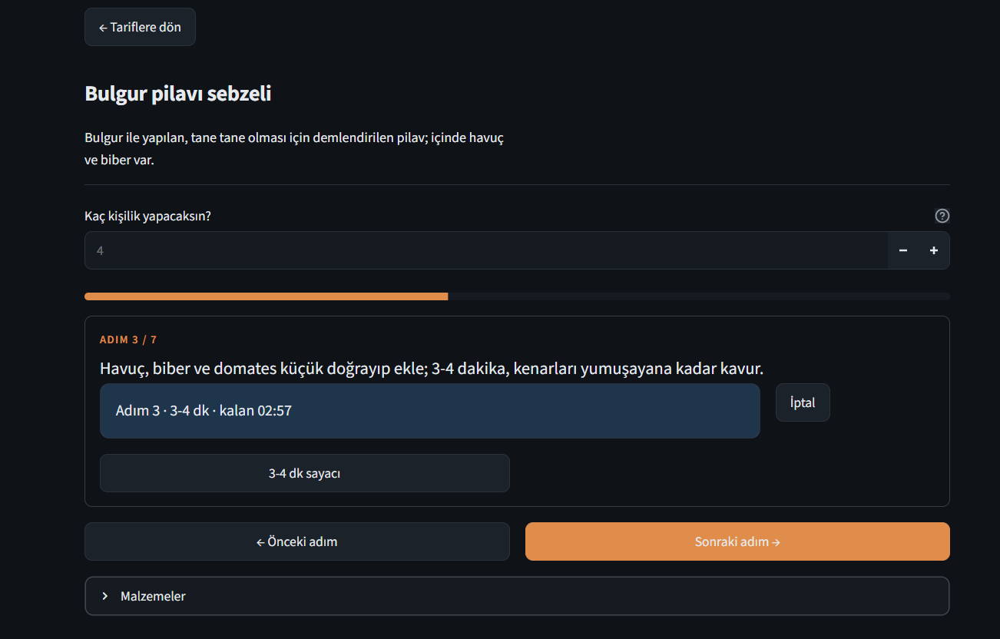
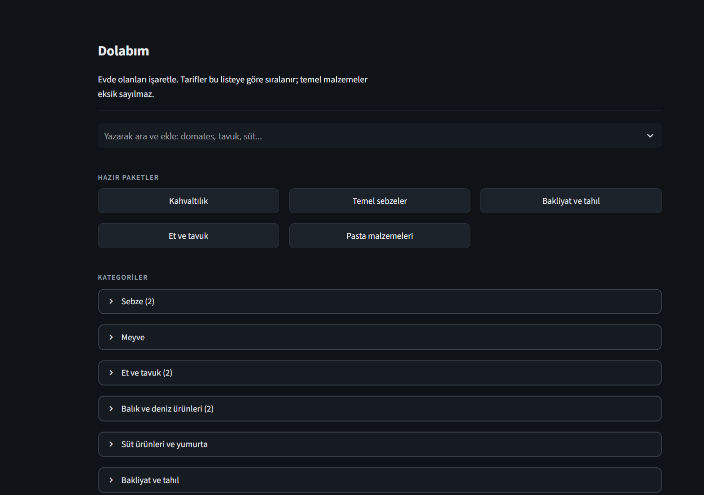
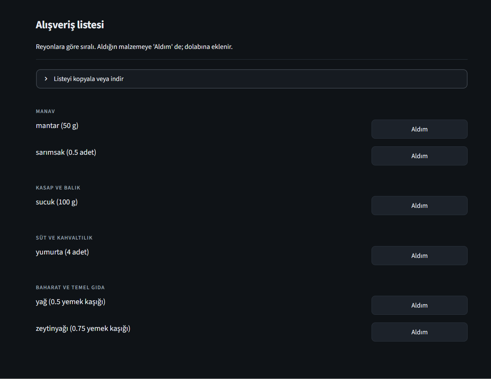

# Yemek Planlayıcı ve Alışveriş Listesi

Dolabındaki malzemelere göre ne pişirebileceğini gösteren, haftalık menü planlayan ve eksik malzemelerden reyonlara göre gruplanmış alışveriş listesi çıkaran bir web uygulaması. Python, Streamlit ve SQLite ile yazıldı.

## Ekran görüntüleri

**Tarifler:** dolaptaki malzemelere göre eşleşme oranı, kalori ve protein, eksik malzemeler.



**Tarif detayı:** malzemeler ve adım adım yapılış.



**Pişirme modu:** kişi sayısına göre ölçeklenen adımlar ve zamanlayıcı.



**Dolap:** hazır paketler ve kategorilere göre malzeme seçimi.



**Alışveriş listesi:** reyonlara göre gruplanmış, kopyalanabilir ve indirilebilir.



## Özellikler

- **Tarif bulma:** Dolaptaki malzemelerle eşleşme oranına göre sıralama; eksik malzemeler ayrıca gösterilir. Kahvaltı, yemek ve tatlı filtresi, süre ve sıralama seçenekleri.
- **Dolap yönetimi:** Miktar ve birimle stok takibi. Yemek bittiğinde kullanılan miktar dolaptan düşer (1 kg biberden 2 tane kullanılırsa kalan miktar korunur). Birimler arası çevirme desteklenir.
- **Kişi sayısına göre ölçekleme:** Malzeme miktarları ve adım metinlerindeki miktarlar birlikte güncellenir.
- **Adım adım pişirme modu:** Hazırlık, adımlar ve bitiş aşamaları; süre algılayan zamanlayıcılar.
- **Haftalık plan:** Gün ve öğüne göre menü, birleşik alışveriş listesi.
- **Alışveriş listesi:** Reyonlara göre gruplama, panoya kopyalama ve indirme.
- **Beslenme ve tercihler:** Diyet türü, alerjiler, mutfak ekipmanı profili, besin değeri hesabı ve hedefe göre sıralama.
- **Tarifler:** 741 hazır tarif, her biri için açıklama, ayrıntılı adımlar ve püf noktası. Kendi tariflerini ekleyebilirsin.
- **Koyu ve açık tema.**

## Kurulum

Python 3.12 önerilir.

```bash
git clone https://github.com/kubra-jpg/yemek-planlayici.git
cd yemek-planlayici

python -m venv .venv
# Windows (PowerShell):  .venv\Scripts\Activate.ps1
# macOS / Linux:         source .venv/bin/activate

pip install -r requirements.txt
streamlit run app.py
```

İlk çalıştırmada veritabanı ve hazır tarifler otomatik oluşturulur.

## Testler

```bash
pytest
```

## Proje yapısı

```
app.py                 Arayüz (Streamlit)
update_recipes.py      data/recipes.json içeriğini mevcut veritabanına uygular
core/
  repository.py        Veritabanı erişimi
  matcher.py, units.py, filters.py   Eşleştirme, birimler, filtreleme
  deduct.py, shopping.py, planner.py Stok düşme, alışveriş listesi, haftalık plan
  cooking.py, timers.py              Ölçekleme, pişirme modu
  diet.py, equipment.py, nutrition.py, goals.py
  ui.py                Tema ve arayüz bileşenleri
data/                  Tarifler, açıklamalar, ekipman verisi
tests/                 Birim testleri
```

Mantık katmanı (`core/`) arayüzden bağımsız saf Python modüllerinden oluşur ve ayrı ayrı test edilir.

## Lisans

MIT, ayrıntılar için `LICENSE` dosyasına bak.
